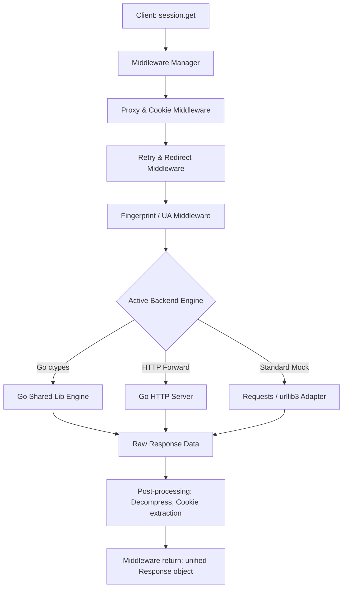
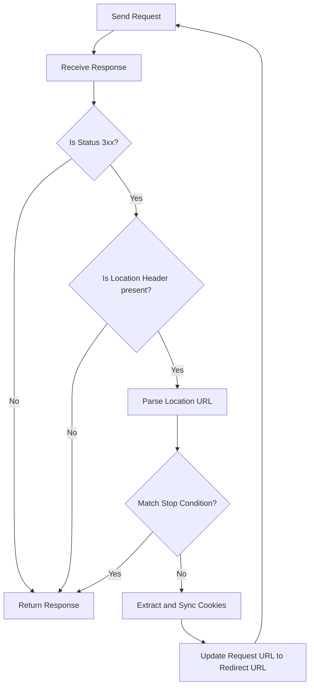

# Python TLS Client Blueprint & Design Document

This document serves as the architectural blueprint for building our own custom, high-fidelity TLS Client in Python. It is based on a detailed study of four existing implementations in the workspace (`tls-api`, `noble-tls`, `requests-pro`, and `wreq-python`), taking inspiration from their strengths while avoiding their limitations to form a clean, modular, and performance-optimized architecture.

---

## 1. Analysis and Comparison of Existing Projects

The workspace contains four distinct approaches to solving the problem of TLS fingerprint emulation and anti-bot bypass. Below is a comparative analysis of their architecture, mechanics, and design tradeoffs:

### A. `tls-api` (Go + Fiber HTTP Server Wrapper)
*   **Core Mechanics**: Runs a Go-based Fiber HTTP server that wraps bogdanfinn's Go `tls-client` library. It exposes a single POST endpoint `/tls/forward`.
*   **Control Mechanism**: The client passes all request configurations (target URL, method, TLS profile, proxy, header order, etc.) as custom HTTP headers prefixed with `x-tls-` (e.g., `x-tls-profile`). The body of the request is forwarded as-is.
*   **Key Strengths**:
    *   **Decoupled Language Support**: Any programming language capable of making standard HTTP requests can use this API.
    *   **Centralization**: Ideal for microservice architectures or distributed scraping systems where a central cluster of Go servers handles all outbound requests.
*   **Weaknesses**:
    *   **Network Overhead**: Every HTTP request requires a double-hop (Client $\rightarrow$ Go Wrapper Server $\rightarrow$ Target Server).
    *   **Cookie Translation**: The Go Fiber server must parse and manually translate cookies between the client request and the forwarded HTTP client.

### B. `noble-tls` (Python + ctypes Wrapper of `tls-client`)
*   **Core Mechanics**: Directly loads the pre-compiled Go shared library (`.dll`, `.so`, `.dylib`) into Python via `ctypes` bindings.
*   **Update Mechanism**: Includes a dynamic dependency updater (`updater/file_fetch.py`) that queries GitHub releases for the latest version of `bogdanfinn/tls-client`, downloads the appropriate library binary for the current OS/architecture, and logs the version in a `.version` file.
*   **Concurrency**: Because blocking `ctypes` calls block the Python GIL, `noble-tls` offloads requests to `asyncio`'s thread pool executor using `loop.run_in_executor`.
*   **Cookie Syncing**: Explicitly fetches and writes cookies to the Go session memory via custom Go-exported functions (`getCookiesFromSession`, `addCookiesToSession`).
*   **Key Strengths**:
    *   **In-Process Execution**: Zero network overhead since the Go runtime runs inside the Python process.
    *   **Fully Async**: Standardized around modern Python async patterns.
*   **Weaknesses**:
    *   **Shared Memory Safety**: C-bindings introduce risks of memory leaks or segmentation faults if pointers are not freed correctly.
    *   **Dynamic Library Load Errors**: Gatekeeper/Defender flags can block untrusted `.dylib` or `.dll` files on macOS/Windows.

### C. `requests-pro` (Object-Oriented Middleware & Adapter Framework)
*   **Core Mechanics**: Focuses heavily on developer ergonomics and GoF design patterns (Adapter, Proxy, Decorator, Factory, Strategy). It defines a unified abstract client interface (`abstractClient.py`) and provides adapters for standard `requests` and Florian REGAZ's `python-tls-client`.
*   **Middleware Pipeline**: Uses a Python decorator `request_through_middleware` to wrap request execution, handling:
    *   Status code inspection (raising specific exception types like `AntiBotBlockError`, `UnauthorizedError`, `NotFoundError`).
    *   Automatic retry logic for timeouts and connection failures.
    *   **Manual Redirection Interceptor**: Disables auto-redirects in the underlying HTTP clients and runs a manual redirection loop to resolve relative URLs and support redirect conditions (e.g., `middl_redirect_endpoint_stop`).
*   **Fingerprint Alignment**: Dynamically constructs platform-matching User-Agents and HTTP/2 Client Hints (`Sec-Ch-Ua-*`) using structured version and subsystem tables (`chrome_version_info.json`, `chrome_subsystem_info.json`).
*   **Charles Proxy Auto-routing**: Detects if Charles Proxy is running on localhost port 8888 and automatically injects proxy configurations for decryption/debugging.
*   **Key Strengths**:
    *   **Pattern-Rich Structure**: High reusability and extensibility. Adding a new client engine is as simple as creating a new subclass of `MiddlewareClient`.
    *   **High-fidelity User Agent generation**: Aligns UA strings and client hint platforms to match the TLS fingerprint.
*   **Weaknesses**:
    *   **Buggy Redirect Logic**: The relative redirection resolver (`_check_for_redirects`) incorrectly processes absolute URLs from external domains, adding local base host paths to them.

### D. `wreq-python` (Rust + PyO3 Native Extension Wrapper)
*   **Core Mechanics**: Implements a native compiled Python extension written in Rust using PyO3 and Maturin. Under the hood, it uses the Rust `wreq` crate, which leverages Google's BoringSSL for low-level TLS tuning and Tokio for asynchronous networking.
*   **TLS Configuration**: Exposes a rich API (`TlsOptions`) that gives developers control over ALPN, ALPS, GREASE extensions, extension permutation, session tickets, record size limits, key shares, and custom cipher lists.
*   **Device Emulation**: Features over 100+ native browser/client profiles (Chrome, Edge, Firefox, Safari, OkHttp, Opera) mapped as rust-based configurations.
*   **Performance**: Bypasses the Python GIL completely during socket operations, using a native Tokio runtime to handle networking at C-speed, resulting in performance that outperforms typical Python wrappers.
*   **Key Strengths**:
    *   **C-Level Performance**: High throughput, memory safety, and thread safety.
    *   **Surgical TLS Manipulation**: Allows setting low-level parameters that Go packages abstract away.
*   **Weaknesses**:
    *   **Compilation Complexity**: Requires a complex build environment (CMake, Perl, compiler toolchain, BoringSSL library dependencies) to compile the wheel.

---

## 2. Key Design Tradeoffs and Lessons Learned

1.  **Alignment of Signatures**: Anti-bot engines (Akamai, Cloudflare, etc.) cross-reference the TLS JA3/JA4 fingerprint against the HTTP/2 settings, the HTTP/2 pseudo-header order, the User-Agent, and Client Hints (`Sec-Ch-Ua`). If a JA3 fingerprint says "Chrome 120" but the User-Agent claims "Firefox" or "Chrome 130", the request is instantly flagged. We must enforce strict co-dependency: picking a browser profile must automatically apply matching JA3/JA4, HTTP/2 settings, Header Order, User-Agent, and Client Hints.
2.  **Redirection Handling**: Standard libraries often handle redirects internally, which hides the intermediating states and cookies. Running a manual redirect loop inside Python middleware (while disabling redirect handling in the underlying engine) is the best pattern. It permits intercepting redirects (e.g. stopping at a login success page) and resolving cookies at each hop.
3.  **GIL Blocking in C-Bindings**: Python's GIL must be released during socket I/O. If using ctypes, socket operations block the main thread. Thread-pool execution via `asyncio.run_in_executor` is a necessary wrapper pattern to maintain an async Python API.
4.  **Local Debugging Support**: Building in auto-detection for debugging proxies (like Charles Proxy or Fiddler) is a massive quality-of-life feature for developers testing TLS fingerprints.

---

## 3. Custom Python TLS Client Blueprint

Our custom Python TLS implementation will be structured under a unified, clean Python codebase called **`horaa-tls`**. It will utilize a **Pluggable Backend Strategy** (supporting both a dynamic-library Go backend and a Rust native backend) combined with a robust **Middleware Request Pipeline**.

### Proposed Project Directory Structure

```text
horaa_tls/
│
├── __init__.py                # Package exports (Session, Response, presets)
├── client.py                  # Main Session and Client classes (unified sync/async API)
├── response.py                # Custom Response class (mimics httpx/requests)
│
├── backend/                   # Pluggable request execution engines
│   ├── __init__.py            # Abstract Base Backend
│   ├── ctypes_go.py           # ctypes loader for bogdanfinn's compiled Go library
│   ├── http_forward.py        # Forwarding client for remote/local TLS servers
│   └── mock_engine.py         # Standard fallback adapter wrapping urllib3/requests
│
├── middleware/                # Custom pre/post request processors
│   ├── __init__.py            # Pipeline controller
│   ├── retry.py               # Retries connection errors and timeouts
│   ├── redirect.py            # Manual redirect handler and stop conditions
│   ├── cookies.py             # Cookie sync between Python CookieJar and backend engine
│   └── proxy.py               # Rotating proxy manager
│
├── fingerprint/               # TLS & HTTP/2 preset profiles and UA generation
│   ├── __init__.py            # Profile Manager
│   ├── profiles/              # JSON definitions of matching browser profiles
│   │   ├── chrome.json
│   │   └── firefox.json
│   └── user_agent.py          # Dynamic platform-matching UA & Client Hints builder
│
└── utils/                     # Helper utilities
    ├── __init__.py
    ├── proxy_detector.py      # Autodetect Charles/Fiddler
    └── updater.py             # Automatic library binary downloads and logging
```

---

## 4. Key Component Workflows

### Request Execution Pipeline

The diagram below shows how a call to `session.get()` flows through our modular components:



### Manual Redirect Loop Flowchart

To circumvent library-level redirection bugs, we disable internal redirect features and execute redirects manually within a middleware hook:



---

## 5. Detailed Component Specifications

### 1. Pluggable Backend Adapters
An abstract class `BaseBackend` defines the signature:
*   `def execute(self, request_payload: dict) -> dict`
*   `async def execute_async(self, request_payload: dict) -> dict`

The `CtypesGoBackend` loads the Go shared library. To ensure memory safety:
*   The Go side exports a `freeMemory(id: c_char_p)` function.
*   The Python caller reads the Go response, deserializes the JSON string, and calls `freeMemory` immediately in a `finally` block to release Go-allocated C-strings.
*   Async calls utilize `asyncio.get_running_loop().run_in_executor(None, lib.request, payload)`.

### 2. The Middleware Pipeline
Instead of hardcoding features in the main `Session`, we define a middleware list:
*   `before_request(self, session, request_config)`
*   `after_response(self, session, request_config, response)`

**Redirect Middleware**:
*   Intercepts HTTP status codes `300-399`.
*   Resolves location paths (handles relative paths, query strings, and absolute redirects properly).
*   Allows stopping redirects at target endpoints containing specific strings (e.g., `redirect_endpoint_stop="oauth/callback"`).

**Cookie Sync Middleware**:
*   Tracks session cookies in a Python `RequestsCookieJar`.
*   Injects cookies into the `request_payload` for ctypes before execution.
*   Parses returned `Set-Cookie` response headers or queries the backend engine's internal cookie jar to update the Python `Session.cookies` container.

### 3. Fingerprint Alignment & Presets
Profiles are defined as static configurations:
*   Includes JA3 string, ALPN list, TLS extension list, HTTP/2 settings, pseudo-header order, and default headers order.
*   The `UserAgentGenerator` parses the selected client version and operating system, selecting a matching subsystem template.
*   Generates accurate Client Hints:
    ```json
    {
      "User-Agent": "Mozilla/5.0 (Windows NT 10.0; Win64; x64) AppleWebKit/537.36 (KHTML, like Gecko) Chrome/120.0.0.0 Safari/537.36",
      "Sec-Ch-Ua": "\"Not_A Brand\";v=\"8\", \"Chromium\";v=\"120\", \"Google Chrome\";v=\"120\"",
      "Sec-Ch-Ua-Mobile": "?0",
      "Sec-Ch-Ua-Platform": "\"Windows\""
    }
    ```

### 4. Session State Serialization
To facilitate distributed scraping and session persistence:
*   `Session.to_json()` exports session headers, active proxies, cookies serialized as lists of dictionaries, and fingerprint profile settings.
*   `Session.from_json(json_data)` recreates the session state, populating backend connections and headers.

---

## 6. Implementation Timeline Plan

1.  **Phase 1: Project Setup & Utils**: Build directory structure, configure absolute/relative imports, create dependency updater script for downloading latest precompiled Go binaries.
2.  **Phase 2: Pluggable Engine Backends**: Implement `BaseBackend` and code the `CtypesGoBackend` utilizing Python's `ctypes`.
3.  **Phase 3: Middleware Request Pipeline**: Build the middleware manager and implement cookie sync, custom retries, and the robust manual redirection loop.
4.  **Phase 4: Fingerprint and User-Agent Engine**: Create browser profiles, design the matching User-Agent and Client Hints generator.
5.  **Phase 5: Verification & Testing**: Verify TLS fingerprints against remote testing sites (e.g., `https://tls.peet.ws/api/all`), validate proxy rotation, and check memory safety.
